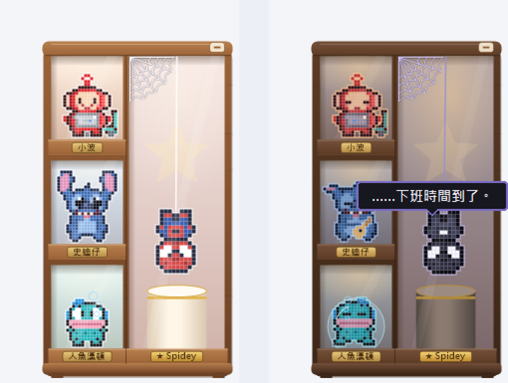

# 公仔櫃 Desk Pals

螢幕右下角的木頭公仔櫃，住著四隻像素公仔。挑一隻出來，他就在整個螢幕陪你工作；全部放出來，他們還會串門子。
公仔櫃有兩櫃可以換：**經典一櫃**（Spidey、小波、史迪仔、人魚漢頓）和 **天線寶寶一櫃**（丁丁、迪西、拉拉、小波）。



> 個人粉絲作品，非商業用途，與各角色的版權方（Marvel、Ragdoll／WildBrain、Disney、Sanrio）無關。

## 選你的公仔


| | 公仔 | 怎麼動 | 招牌 | 下班時間 |
|---|---|---|---|---|
| 🕷 | **Spidey** | 噴絲擺盪、倒吊、爬牆 | 「蜘蛛感應！」 | 黑化，冷冷地催你下班 |
| 🛴 | **小波** | 騎滑板車在視窗間飛 | 肚子電視顯示 Codex／Claude 狀態；棒球接球、揮棒全壘打 | 太陽寶寶下山，想睡覺 |
| 👽 | **史迪仔** | 四腳快跑、爬牆、倒掛、縮成球滾 | 「Ohana！」、彈烏克麗麗 | 抱著烏克麗麗打哈欠 |
| 🐟 | **人魚漢頓** | 像在水裡游、吐泡泡；披風英雄飛行 | 冷笑話「好笑嗎？好笑嗎？」 | 睡在泡泡裡 |

- **點櫃子裡的公仔**叫他出來；**往右下一甩**就丟回櫃子（「進球！🏀」）。
- 櫃子可以**收合成一顆蛋**，點蛋就打開。
- 平日 **12:00–13:30 午餐變身**：Spidey 吃披薩、小波捧嘟嘟糊、史迪仔啃三明治、人魚漢頓喝港式奶茶配菠蘿油，吃飽還會睡午覺。

全部放出來時，他們碰在一起會有專屬劇情：史迪仔偷騎小波的滑板車、Spidey 用絲把小波盪上高處、人魚漢頓想跟 Spidey 學當英雄……還會一起拍大合照、打迷你棒球賽。

## 天線寶寶一櫃


大格是小波，左邊三格是丁丁、迪西、拉拉。四隻都用小波的像素母版，只換顏色和天線；格子裡是藍天綠山丘，大格有太陽寶寶（下班時間會下山）。

| | 公仔 | 怎麼動 | 招牌 | 下班時間 |
|---|---|---|---|---|
| 👜 | **丁丁** | 最高、走得慢慢的，提著紅色魔法袋 | 翻魔法袋（吐司、愛心、星星…）；常常跌坐「哎喲！」；愛跳舞 | 抱著袋袋打瞌睡 |
| 🎩 | **迪西** | 跟著節奏一點一點地走，有點酷 | 黑白乳牛紋高帽：丟起來接住、摘下來揮、用帽子頂球，就是不借人 | 帽子拉低蓋住眼睛 |
| 🟠 | **拉拉** | 蹦蹦跳跳、邊走邊帶球 | 顛球、轉圈圈、唱「啦啦啦～」 | 坐著抱球睡 |
| 🛴 | **小波** | 跟經典一櫃同一隻 | 滑板車、棒球 | 太陽寶寶下山 |

- 串場：丁丁借戴迪西的帽子結果跌倒、拉拉的球滾進魔法袋（先拿出吐司）、迪西和拉拉比跳舞、丁丁借騎小波的滑板車、小波打棒球給迪西用帽子頂、拉拉踢球給小波騎車去撿。
- 三隻以上：大抱抱、拉拉起頭一起唱歌、「一、二、三」一起跌倒、吐司時間（吐司彈出來，屑屑掉滿地，小幫手「吸吸」來打掃）、大合照；右鍵選單「天線寶寶一起…」也能叫。
- 早上點名「丁丁！迪西！拉拉！小波！」，下班時間一隻一隻「說再見」回櫃子。
- 午餐：丁丁吃吐司、迪西吃嘟嘟糊（帽子不拿下來）、拉拉吐司沾嘟嘟糊。
- 換櫃：VS Code 指令「公仔櫃：換一櫃」，或設定 `deskPals.lineup`（`classic`／`teletubbies`），當場換、不用重開；挑公仔時選天線寶寶也會直接換過去。

## 陪你工作

- **Codex／Claude Code 卡住、做完** → 跳出來叫你
- **上版** → 推 tag 後盯著 CI，部署成功或失敗告訴你
- **開會** → 會前提醒、點公仔進會議、開會中自動安靜
- **提醒我…／搶票提醒 🎫** → 時間到來敲你；搶票有倒數和時鐘校對
- **專注 🍅／安靜一下** → 番茄鐘、勿擾時段
- **Jira、GitLab 待辦**、下雨、電腦狀況、下載完成、今天的小結

全部在你電腦上跑，不用任何付費服務，也不會把你的資料送出去（行事曆、Jira、GitLab 都只用你自己的帳號讀取）。

## 安裝

一個 `.vsix` 同時支援 Windows 和 Mac，在 VS Code 安裝。

- **Windows**（完整公仔櫃）：見 [Windows安裝說明.md](Windows安裝說明.md)
- **Mac**（目前只有 Spidey）：見 [Mac安裝說明.md](Mac安裝說明.md)，不提供 Mac 支援

`.vsix` 從 [Actions](../../actions) 最新一次成功的建置下載（Artifacts 裡的 `desk-pals-vsix`），或自己打包：

```
python build_vsix.py
```

## 結構

| 路徑 | 內容 |
|---|---|
| `extension/extension.js` | VS Code 擴充：側邊欄、狀態列、啟動桌面版 |
| `extension/practical.js` | 實用功能的資料來源：終端機、CI、行事曆、Jira、GitLab、天氣、工作日誌、提醒 |
| `extension/media/pet.html` | 側邊欄裡的公仔 |
| `extension/desktop/DeskPals.cs` | Windows 桌面版：公仔櫃、兩櫃公仔（經典／天線寶寶）、通知（由 `desk-pals.ps1` 用 PowerShell 編譯執行） |
| `extension/desktop/SpideyDesktop.swift` | Mac 桌面版（只有 Spidey，由 `spidey-desktop.sh` 編譯執行） |
| `extension/desktop/claude-hook.js`、`ci-watch.js` | Claude Code hooks、推 tag 後盯 CI |
| `build_vsix.py` | 打包成 `.vsix` |

每次推送都會在雲端的 Windows 和 Mac 上各編譯、試跑一次（Windows 用不顯示畫面的離屏模式）。
