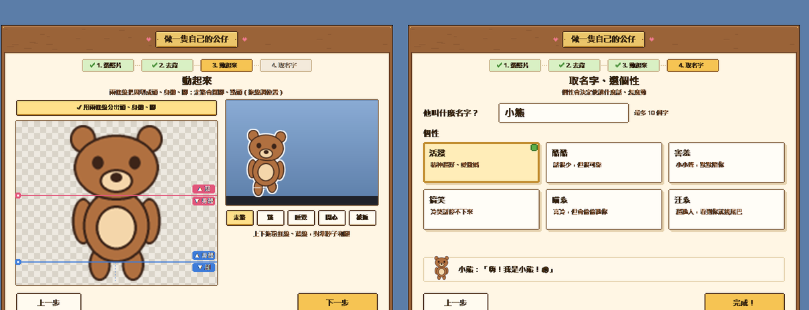

# 公仔櫃 Desk Pals

**把你家的貓狗（或任何照片）變成桌面公仔。** 選一張照片，去背、取名字、挑個性，一分鐘就有一隻自己的公仔住在螢幕右下角的蛋裡：在視窗上散步、跳上跳下、找你撒嬌，工作上有事會來提醒你，平日下班時間還會催你回家。

也有現成的原創一櫃 **續命小隊**（住在網購紙箱裡的**躲躲**、一顆很累的電池**沒電**、嘴硬心軟的仙人掌**刺刺**），全新安裝預設選好的就是這一櫃：住在右下角的紙箱公仔櫃，挑一隻出來陪你上課、工作、熬夜；全部放出來，他們還會串門子。

## 續命小隊

你每天的狀態，變成了會動的公仔：想躲起來的你、快沒電的你、嘴硬說不累的你。全新安裝預設就是這一櫃。

| | 公仔 | 個性 | 招牌 |
|---|---|---|---|
| 📦 | **躲躲**（住在網購紙箱裡） | 好奇又害羞，口頭禪「我不在」 | 被嚇到（游標衝過來、新視窗跳出來、通知、錯誤變多）就**縮回箱子**、只從提手洞露出眼睛；躲著被你點到 →「被發現了！」**箱子長腳逃跑**到螢幕另一邊再探頭 |
| 🔋 | **沒電**（一顆電池） | 很累但還得繼續 | **身體裡的電量跟你的工作時間連動**：一直工作慢慢掉（到休息提醒時大約剩一成），休息（離開電腦、鎖螢幕、午餐）就插上**充電**、變綠色；電用完會**攤平**冒出小鬼魂，等你去休息才起來。電越少走越慢 |
| 🌵 | **刺刺**（盆栽仙人掌） | 嘴硬心軟 | 嘴硬講完馬上被你摸 → 被拆穿，**開花**（「這、這是花粉過敏！」）；被甩、被狂點、錯誤變多就**炸毛** |

- **沒電的電量**：右鍵沒電（第一行）或滑鼠停在他身上就看得到百分比；低電量紅、中間黃、高電量綠，充電中是綠的、會微微閃（系統開了「減少動態」就不閃）。關掉 Desk Pals 的時間也算休息。公仔小屋 →「沒電的電量跟工作時間連動」或 VS Code 設定 `deskPals.battery.link` 可以關掉（關掉＝永遠滿電、不攤平）。
- **點櫃子裡的公仔**叫他出來；**往右下一甩**就丟回櫃子。公仔櫃是網購紙箱疊成的（跟他們同一種貼紙畫風，晚上會跟著暗下來），右邊高高的大格是最愛（預設躲躲），空著的第 4 格是「做一隻你的公仔」入口。
- **全部放出來會串門子**：沒電把插頭插在刺刺的盆土裡充電（「插哪裡啊！」…「只准充一下」）、躲躲把箱子讓給沒電當床、刺刺嘴上說不在乎躲躲，躲躲一躲起來就開始找人。
- **大家一起**：下午三點續命、大合照、早上點名「續命小隊，報到！」、下班時一個一個回櫃子（沒電走最慢，最後一個）。右鍵選單「續命小隊一起…」也能叫。
- **午餐**（平日 12:00–13:30）：一起吃便當；對沒電來說，吃飯＝人類的充電。
- 2026 年 11 月以前的像素版續命小隊（半糖、醒醒、糰糰、貼貼）退休了；好感度、櫃子、最愛會自動轉給新三隻（半糖→躲躲、醒醒→沒電、糰糰→刺刺）。

個人版（自己打包的）還有幾櫃粉絲作品，見下面「[換一櫃](#換一櫃)」；公開下載的版本只有續命小隊和你自己做的公仔。

## 做一隻自己的公仔 🐾

第一次打開時的設定視窗就有「把你家的貓狗（或任何照片）變成桌面公仔」；之後隨時從**公仔小屋**（蛋或櫃子按右鍵）→「做一隻自己的公仔」再做一隻、修改、刪除。

1. **選照片**：PNG、JPG、GIF、BMP 都可以，拖進視窗或點一下選檔。
2. **去背**：本來就是透明背景的圖直接用；一般照片會自動去背（從照片四邊取背景色，毛邊會半透明，只留下最大的那一塊）。沒去乾淨就調「去背強度」，或用「擦掉／補回」筆刷在圖上塗一下修正。
3. **動起來**：兩條線把圖切成頭、身體、腳（會自動猜位置，可以拖），走路會擺腳、點頭、跳起來拉長、被抓起來晃來晃去、睡覺歪一邊。不切線也行，整隻一起搖搖晃晃。
4. **取名字、選個性**：活潑、酷酷、害羞、搞笑、喵系、汪系。個性決定他講什麼話、怎麼動：喵系會跳上視窗頂端坐著、窩成貓貓窩、偶爾把小杯子推下視窗、摸他有時候不理你等一下又自己跑回來；汪系會搖尾巴、把你丟的球叼回來、你離開電腦回來時開心地跳。

風格可以選 **保留原圖**（照片原本的樣子，邊緣平滑）或 **像素風**（縮成跟內建公仔一樣的像素畫、減色、加深色外框）。大小會自動調成跟內建公仔差不多，櫃子、蛋都放得下。

小技巧：
- **去背好的透明 PNG 效果最好**；主角站在單純的背景前（白牆、地板）也很好去背。
- 背景很亂的照片，可以先用免費的線上去背工具做成透明 PNG 再放進來。
- **照片只存在你的電腦裡**，不會上傳到任何地方（全部在本機算，不用任何網路服務或 AI）。

**進階：動作表**。想自己畫每一個動作的話，按「下載動作表範本」，在格子裡畫好「站、走 1、走 2、跳、睡、開心、被抓、坐」（至少要畫「站」，空格會自動補動畫），再按「上傳畫好的動作表」。

**我的櫃**：做了自己的公仔之後多一櫃「我的櫃」，最多放 4 隻（自己做的優先，空的格子可以請內建公仔來作客，跟他們串門子：打招呼抱抱、聊天、傳球）。也可以「只要一隻」，讓他自己住在蛋裡。

**分享短片**：小屋或公仔的右鍵選單「做分享短片（GIF）」，會在背景畫一段 5 秒的小短片（走進來、打招呼、開心跳兩下冒愛心，右下角有 Desk Pals 小浮水印），存到「圖片\Desk Pals」，順便把一句分享用的話（例如「我家 ○○ 住進我電腦了 🐾 #我的桌面公仔 #DeskPals」）複製到剪貼簿。短片是程式自己畫的，不會錄到你的螢幕。

**傳給朋友**：小屋 →「我的公仔」→「匯出成檔案」存成一個 `.deskpal` 檔；朋友在小屋或第一次設定按「匯入朋友的公仔」（或直接拖進「做一隻自己的公仔」視窗）就能養同一隻。只有自己做的公仔能匯出。

## 換一櫃

除了續命小隊，原始碼裡還有幾櫃**個人粉絲作品**（經典一櫃：Spidey、小波、史迪仔、人魚漢頓；天線寶寶一櫃：丁丁、迪西、拉拉、小波；皮克敏一櫃：紅、黃、藍皮克敏＋休息花）。這幾櫃只供自己玩，不放在宣傳圖裡，**也不在公開下載的版本裡**：

- **公開版**（Releases、Microsoft Store、Steam、DMG 都是這個）：只有續命小隊＋自己做的公仔（我的櫃）。由 `tools/variant.py` 從原始碼減掉粉絲作品產生，打包時會掃一遍，有任何粉絲角色的名字、口頭禪、像素圖就建置失敗。
- **個人版**：全部的櫃。自己打包（`python build_vsix.py` 會同時打出 `desk-pals-<版號>-personal.vsix`；`build.ps1 -Variant personal`、`VARIANT=personal packaging/mac/build_app.sh`），或從 CI 的 `personal-build-windows` artifact 拿；檔名都帶 `-personal`，不要公開散布。

> 粉絲作品的幾櫃為個人非商業用途，與各角色的版權方（Marvel、Ragdoll／WildBrain、Disney、Sanrio、Nintendo）無關。續命小隊是原創角色。

- 換櫃：VS Code 指令「公仔櫃：換一櫃」、蛋的右鍵「公仔小屋 → 換一櫃」，或設定 `deskPals.lineup`（`original`／`classic`／`teletubbies`／`pikmin`，做了自己的公仔之後還有 `mine`＝我的櫃），當場換、不用重開。
- 舊使用者更新後**不會被換櫃**：沒設定過 `deskPals.lineup` 的話，照桌面版上次用的那一櫃；只有全新安裝才預設續命小隊。

## 陪你工作

- **Codex／Claude Code 卡住、做完** → 跳出來叫你
- **上版** → 推 tag 後盯著 CI，部署成功或失敗告訴你
- **開會** → 會前提醒、點公仔進會議、開會中自動安靜
- **提醒我…／搶票提醒 🎫** → 時間到來敲你；搶票有倒數和時鐘校對
- **專注 🍅／安靜一下** → 番茄鐘、勿擾時段
- **Jira、GitLab 待辦**、下雨、電腦狀況、下載完成、今天的小結

全部在你電腦上跑，不用任何付費服務，也不會把你的資料送出去（行事曆、Jira、GitLab 都只用你自己的帳號讀取）。

## 陪你讀書

不分學生、上班族，功能都在；有資料的才會動（沒填學校行事曆就不會有上課、作業提醒）。全部由桌面版做，**沒有 VS Code 也能用**（Windows、Mac 都有）。

| 功能 | 做什麼 | 要設定什麼 |
|---|---|---|
| 上課提醒 🎒 | 上課前 10 分鐘、開始時各叫一次，點公仔打開上課連結（Meet／Zoom／Teams 或行事曆上的網址）；上課、考試中自動安靜 | 學校行事曆的 ICS 網址 |
| 作業死線 📝 | 截止前 3 天、1 天、3 小時、1 小時提醒，點公仔打開作業頁或標成「交了」；右鍵「小幫手 → 這週要交的」 | 學校行事曆的 ICS 網址 |
| 搶課提醒 🎓 | 跟搶票一樣：選課系統開放前 1–2 小時、30 分、10 分、1 分和開放時叫你，最後 10 分鐘頭上有學士帽倒數 | 不用 |
| 考試倒數 📚 | 考前兩週每天 20:00 倒數、前一天晚上叫你早點睡、當天早上加油；7 天內專注變成「讀書 25 分鐘」 | 不用（自己加；行事曆上寫「期中考」「小考」的也會自動加進來） |
| 熬夜提醒 🌙 | 01:00 後還在用電腦，溫柔催你去睡（02:00、03:00 再講）；你離開電腦就不吵，安靜、專注時不講 | 不用（可以改時間或關掉） |
| 讀書統計 | 今天的小結多了這週吃了幾顆番茄、上了幾堂課、這週還有幾份作業 | 不用 |

設定：桌面公仔小屋（右鍵蛋或櫃子）→「讀書小幫手設定」；有 VS Code 的話也可以設 `deskPals.schoolIcsUrl`（可以放好幾個）、`deskPals.lateNightStart`、`deskPals.examNudgeTime`，設了就以 VS Code 為準。

**學校行事曆的 ICS 網址怎麼拿**（貼 `https://` 或 `webcal://` 開頭的都可以，好幾個就一行一個）：

- **Canvas／NTU COOL**：左邊「行事曆」→ 右邊欄最下面「Calendar Feed（行事曆摘要）」→ 複製網址。作業、測驗、討論區的截止都在裡面。
- **Moodle**：「行事曆」→「匯入或匯出行事曆」→「匯出行事曆」→ 事件選「所有事件」、時間選最近和接下來 →「取得行事曆網址」→ 複製。
- **Google Classroom**：課程的「課業」頁 →「Google 日曆」打開這門課的日曆 → 在 Google 日曆左邊找到這門課 →「設定和共用」→「iCal 格式的私密網址」。每門課一個網址。（學校帳號如果被管理員關掉私密網址，就請老師或助教把作業同步到 Canvas／Moodle。）
- **自己排的 Google 日曆課表**：Google 日曆設定 → 你的日曆 →「iCal 格式的私密網址」。每週重複的行程會被當成「上課」。

私密網址等於帳號密碼，不要貼給別人；公仔櫃只用它讀你的行事曆。

## 搗蛋 😈

四個惡作劇，會讓你想錄螢幕分享的那種。開關在桌面公仔小屋（右鍵蛋或櫃子）→「搗蛋（惡作劇開關）」，或 VS Code 設定 `deskPals.mischief.*`（設了就以 VS Code 為準）。

**公開版（Microsoft Store、公開下載）四個全部預設關**；第一次在小屋打開某一個時，會先跳說明（會做什麼、怎麼停、不會做什麼），按「好，打開」才開始。從舊版升級的維持原本的開關。下表的「預設」是個人版。

| 玩法 | 什麼時候 | 會怎樣 | 預設 |
|---|---|---|---|
| 搶游標 | 滑鼠鍵盤都沒動 3 分鐘（可以改 1／3／5／10 分） | 公仔撲過來把游標叼走、拖著跑一小段放下：「你的游標我先保管」 | **關**（要玩自己開） |
| 下班清場 | 平日 18:00 後（跟「下班時間」同一套），你在電腦前，一天一次 | 公仔把前面幾個視窗推出螢幕：「下班了，視窗都回家了」，點公仔全部叫回來 | 開 |
| 購物警察 | 前景是購物網站（蝦皮、momo、PChome、露天、淘寶、Amazon、樂天、博客來、Yahoo 購物中心…） | 抱著錢包大哭：「這個月已經買第三次了欸」，20 分鐘內不再哭 | 開 |
| 打字太兇 | 連續 4 秒、平均每秒按 9 下以上 | 被震飛出去、暈一下、再爬回來 | **關**（要玩自己開） |

**隱私與安全**

- **打字太兇只數「每秒按了幾下」**：Windows 只把「放開按鍵」的次數加一，Mac 讀系統的按鍵計數器；不看按了哪個鍵、不記錄、不存任何內容，也不送到任何地方。關掉開關就不再數；全螢幕（遊戲）時也不數。
- **不會關閉任何東西**：下班清場只是把視窗縮小（Mac：隱藏那個 App），點公仔、點泡泡、小屋選單「把推走的視窗叫回來」或 VS Code 指令「公仔櫃：把下班清場推走的視窗叫回來」一鍵全部回來；收工（關掉 Desk Pals）前也會先全部叫回來。推走時看到的假視窗是那一刻的樣子，只放在記憶體裡、演完就丟（Mac 不擷取畫面，畫成卡通視窗）。
- **搶游標你一動就放手**：滑鼠一動（游標離開公仔放的位置）、按住滑鼠鍵、按任何鍵都算（只在搶游標那幾秒看「有沒有按」，不記是哪個鍵），公仔做「被抓到了」的反應；全螢幕程式、簡報、遊戲、分享螢幕、按著滑鼠鍵、躲起來（Ctrl+Alt+S）、安靜／專注時都不會開始，整段最多 6 秒多。
- 購物警察只看前景視窗的標題，不記錄你逛了什麼（只記這個月哭了幾次）。
- **匿名統計（只有公開版）**：只送「第一次設定選了哪一櫃」「7 天後還開著哪一櫃」到 Google Analytics，每次一個用完就丟的亂數 ID，不帶使用者名稱、電腦名稱、路徑；第一次設定第一頁有說明，小屋選單「匿名回報選了哪一櫃」可以關。個人版完全不送。
- Mac：購物警察要「螢幕錄影」權限才看得到視窗標題（沒有就不會哭）；打字太兇可能要「輸入監控」權限，只在你自己從小屋打開開關時問一次，沒給就安靜地不觸發。

錄宣傳片、測試：pipe 送 `act mischief cursor|clear|shop|typing` 可以直接演一次（`act mischief restore` 叫回視窗）。

## 安裝

三種裝法，挑一種就好（同一台電腦兩種都裝也沒關係，見最下面）。三種都是同一個桌面公仔櫃；第一次打開會跳出設定視窗：做一隻自己的公仔，或選一櫃現成的；預設是「只要一隻」（他住在右下角的蛋裡），想要整個公仔櫃也可以選「整櫃」。

| | Windows 安裝程式 | Mac App（DMG） | VS Code 擴充套件 |
|---|---|---|---|
| 檔案 | `DeskPals-Setup-<版號>.exe` | `DeskPals-<版號>.dmg` | Windows：`desk-pals-<版號>-win32-x64.vsix`（ARM 電腦 `-win32-arm64`）；Mac：`desk-pals-<版號>.vsix` |
| 要先有 | Windows 10／11（不用 VS Code） | macOS 13（Ventura）以後，Apple 晶片、Intel 都可以（不用 VS Code、不用 Xcode） | VS Code（Mac 還要 Xcode Command Line Tools） |
| 桌面公仔櫃、各櫃公仔、串門子、午餐、下班時間 | ✓ | ✓ | ✓ |
| 做自己的公仔、分享短片、`.deskpal` 匯出匯入 | ✓ | ✓ | ✓ |
| 讀書小幫手（學校行事曆、作業、考試、熬夜、搶課） | ✓ | ✓ | ✓ |
| 提醒我、搶票、專注、安靜、Claude Code／Codex 卡住提醒 | ✓ | ✓ | ✓ |
| 只有 VS Code 才有：存檔比讚、錯誤數、打字速度、終端機長指令、推 tag 盯 CI、開會提醒（工作行事曆）、Jira／GitLab 待辦、天氣、工作日誌、側邊欄公仔 | | | ✓ |
| 開機自動出現 | ✓（安裝時可取消） | ✓ | ✓ |

檔案從 [Releases](../../releases) 下載（還沒發版之前：[Actions](../../actions) 最新一次成功的建置 → Artifacts 的 `desk-pals-windows`／`desk-pals-mac`）。這些都是公開版（只有續命小隊＋自己做的公仔）；個人版見「[換一櫃](#換一櫃)」。

### Windows：安裝程式

1. 雙擊 `DeskPals-Setup-<版號>.exe`。
2. 這一版還沒有程式碼簽章，Windows 會跳出藍色的「Windows 已保護您的電腦」：按 **「其他資訊」→「仍要執行」**。（瀏覽器下載時說「不常下載」的話：Edge 按「⋯」→「保留」→「顯示更多」→「仍要保留」；Chrome 按「保留」。）
3. 照畫面按「下一步」：要不要「開機時自動出現在桌面」（預設要）、要不要桌面捷徑 →「安裝」→ 勾「現在就打開公仔櫃」→「完成」。

不用系統管理員權限，裝在 `%LOCALAPPDATA%\Programs\DeskPals`（只給你這個帳號）。之後從「開始」功能表打開「公仔櫃 Desk Pals」；已經開著的話，再點一次它會出來打招呼（躲起來的會現身）。升級：直接執行新版的安裝程式，會先請舊的收工再換新。解除安裝：「設定 → 應用程式 → 公仔櫃 Desk Pals → 解除安裝」，會問要不要一併刪掉你的設定和紀錄（預設保留）。

### Mac：DMG

1. 雙擊 `DeskPals-<版號>.dmg`，把「Desk Pals」拖到旁邊的「Applications（應用程式）」。
2. 到「應用程式」打開 Desk Pals。這一版還沒有 Apple 的公證，第一次會被擋，照下面做一次：
   - **macOS 15（Sequoia）以後**：看到「無法打開」按「完成」→ 打開「**系統設定 → 隱私權與安全性**」，往下捲到「安全性」，在「已阻擋 "Desk Pals"…」旁邊按「**仍要打開**」→ 輸入密碼 → 再按「仍要打開」。
   - **macOS 14 以前**：在「應用程式」裡對 Desk Pals **按右鍵（或 Control＋點一下）→「打開」**→ 再按一次「打開」。
3. 公仔櫃出現在螢幕右下角；之後開機會自動出現（要關：「系統設定 → 一般 → 登入項目」）。沒有 Dock 圖示，點公仔、蛋或櫃子按右鍵就是選單。

直接在 DMG 或「下載項目」裡打開的話，它會提醒你先拖進「應用程式」（不然開機不會自動出現）。

### VS Code 擴充套件

1. VS Code →「延伸模組」→ 右上角「⋯」→「從 VSIX 安裝…」→ 選 `desk-pals-<版號>-win32-x64.vsix`（Windows）或 `desk-pals-<版號>.vsix`（Mac）。
2. 重新開啟 VS Code。Windows 版的 vsix 附了編好的桌面版 `DeskPals.exe`（放到 `%LOCALAPPDATA%\DeskPals\app` 執行）；Mac 第一次會在背景編譯（30 秒到 1 分鐘）。之後開機會自動出現，不用開 VS Code。

細節：[Windows安裝說明.md](Windows安裝說明.md)、[Mac安裝說明.md](Mac安裝說明.md)。自己打包：`python build_vsix.py`（`dist/` 裡會有公開版 `desk-pals-<版號>.vsix` 和個人版 `desk-pals-<版號>-personal.vsix`；只要一種加 `--public` 或 `--personal`）。這兩個是通用版（不帶 exe，Windows 上會退回 `desk-pals.ps1` 即時編譯）；Windows 專用版先用 `build.ps1 -Steps exe` 編 exe，再 `python build_vsix.py --public --target win32-x64 --exe dist\DeskPals.exe`（個人版：`--personal --target win32-x64 --exe dist-personal\DeskPals-personal.exe --out dist-personal`）。

### 兩種都裝

裝了 Windows 安裝程式（或 Microsoft Store 版）／Mac App 之後，VS Code 擴充套件就**不再自己編一份、也不建自己的開機啟動**，只負責連上獨立版（沒開的話叫它起來），VS Code 才有的功能照常送過去。兩邊用同一個資料夾（Windows `%LOCALAPPDATA%\DeskPals`、Mac `~/Library/Application Support/DeskPals`），設定、紀錄、自己做的公仔都是同一份。先用擴充套件、後來才裝獨立版也沒問題：安裝時會請擴充套件那份收工、把開機啟動換成獨立版。解除安裝獨立版之後，擴充套件會回到原本的做法。

自己打包獨立版：Windows `powershell -File packaging\windows\build.ps1`（需要免費的 Inno Setup 6、Windows SDK、Python + Pillow），Mac `packaging/mac/build_app.sh`。兩支預設都打**公開版**（上架、公開下載用）；自己用的個人版加 `-Variant personal`（Windows，產出 `DeskPals-Setup-<版號>-personal.exe`）或 `VARIANT=personal`（Mac，`DeskPals-<版號>-personal.dmg`）。上架、簽章見 [PUBLISHING.md](PUBLISHING.md)。

## 結構

| 路徑 | 內容 |
|---|---|
| `extension/extension.js` | VS Code 擴充：側邊欄、狀態列、啟動桌面版 |
| `extension/practical.js` | 實用功能的資料來源：終端機、CI、行事曆、Jira、GitLab、天氣、工作日誌、提醒 |
| `extension/media/pet.html` | 側邊欄裡的公仔 |
| `extension/desktop/DeskPals.cs` | Windows 桌面版：公仔櫃、各櫃公仔、通知（連同下面的 partial 檔由 `build.ps1` 編成 `DeskPals.exe`，附在 Windows 版 vsix 和安裝程式裡；從原始碼跑時由 `desk-pals.ps1` 用 PowerShell 編譯執行） |
| `extension/desktop/DeskPals.Original.cs` | 續命小隊（躲躲、沒電、刺刺）：讀圖、沒電的電量（液體上色、跟工作時間連動）、角色、動作、串場、舊資料轉移 |
| `extension/desktop/pals/squad/` | 續命小隊的圖（每隻 16 個動作 × 1x／2x，沒電另有電量液體的遮罩）；`tools/squad_art/` 是產生它們的腳本 |
| `extension/desktop/DeskPals.Fan.cs` | 經典一櫃、天線寶寶一櫃（粉絲作品，只在個人版） |
| `extension/desktop/DeskPals.Pikmin.cs` | 皮克敏一櫃（休息花；粉絲作品，只在個人版） |
| `extension/desktop/DeskPals.Study.cs` | Windows 桌面版的讀書小幫手：抓學校行事曆（ICS）、分類上課／作業、搶課、考試倒數、熬夜提醒、讀書小幫手設定視窗 |
| `extension/desktop/DeskPals.Mischief.cs` | 搗蛋：搶游標、下班清場、購物警察、打字太兇（會動到真實電腦的事都在 `MisSys`，離屏測試換成假的 `MisFake`） |
| `test/` | `node --test test/study.test.js test/mischief.test.js`（VS Code 這邊）；`test/desktop-study.js`、`test/desktop-mischief.js`、`test/desktop-squad.js`（桌面版離屏測試，範例 ICS 在 `test/fixtures`） |
| `extension/desktop/DeskPals.Custom*.cs` | 自己做的公仔：去背與像素化（`CustomImage`）、做公仔視窗（`CustomMake`）、六種個性的台詞（`CustomLines`）、畫法與動作、我的櫃（`Custom`） |
| `extension/desktop/DeskPals.Share.cs` | 分享短片（自己寫的 GIF 編碼器）、`.deskpal` 匯出／匯入 |
| `extension/desktop/DeskPals.swift` | Mac 桌面版（DeskPals.cs 的 Swift 移植，由 `desk-pals.sh` 編譯執行；由 `mac/src/*.swift` 經 `python3 mac/assemble.py` 產生，別直接改） |
| `mac/` | Mac 版原始碼與移植規範（`PORTING.md`） |
| `extension/desktop/claude-hook.js`、`ci-watch.js` | Claude Code hooks、推 tag 後盯 CI |
| `build_vsix.py` | 打包成 `.vsix`（公開版＋個人版） |
| `tools/variant.py` | 產生公開版（減掉粉絲作品）＋掃同人字眼的 guard，見下面「改程式時」 |
| `packaging/windows/` | Windows 獨立版：`DeskPals.Main.cs`（exe 進入點）、`build.ps1`（exe → 安裝程式 → MSIX）、`DeskPals.iss`（Inno Setup）、`msix/AppxManifest.xml`（Microsoft Store） |
| `packaging/mac/` | Mac 獨立版：`build_app.sh`（universal `.app` → DMG，可選簽章＋公證）、`Info.plist`；開場邏輯在 `mac/src/95_standalone.swift` |
| `packaging/icons/make_icons.py` | 從續命小隊的像素圖畫出所有圖示（`.ico`、`.icns`、Store 磚、安裝程式圖） |
| `PUBLISHING.md` | 簽章、上架（Microsoft Store、Steam、Apple 公證）要做的事 |

每次推送都會在雲端的 Windows 和 Mac 上各編譯、試跑一次（都用不顯示畫面的離屏模式），也會打包獨立版並實際安裝、升級、解除安裝測一次；推 `v<版號>` 的 tag 會自動建 GitHub Release，附上公開版的安裝程式、DMG、vsix、MSIX（個人版只留在那次建置的 `personal-*` artifact）。

**改程式時（公開版）**：粉絲角色的資料、動作、串場放在 `extension/desktop/DeskPals.Fan.cs`、`DeskPals.Pikmin.cs`、`mac/src/58_fan.swift`、`50_pikmin.swift`，公開版整個檔案不帶。共用程式碼裡碰到粉絲角色的地方（`Is("po")`、`case "spidey":`、台詞表、側邊欄的像素圖…）用 `// <fan>`…`// </fan>` 或行尾 `//@fan` 標起來，公開版要換成別的寫法的那一行寫成 `// <public> …`（標記本身是註解，個人版完全不受影響）。`python -I tools/variant.py public` 產生公開版（`build/public/extension`）並掃一遍；`python3 mac/assemble.py --public` 產生公開版的 `DeskPals.swift`。CI 會編譯、試跑兩個版本。
