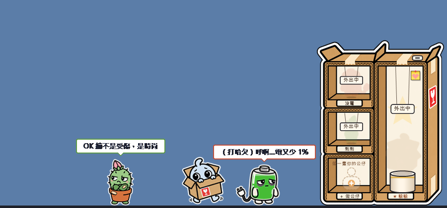
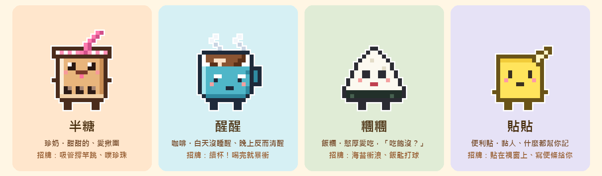

# 公仔櫃 Desk Pals

螢幕右下角的木頭公仔櫃，住著四隻像素公仔。挑一隻出來，他就在整個螢幕陪你上課、工作、熬夜；全部放出來，他們還會串門子。



## 續命小隊

你桌上那幾樣讓你撐過一天的東西，變成了會動的公仔。全新安裝預設就是這一櫃。



| | 公仔 | 怎麼動 | 招牌 | 下班時間 |
|---|---|---|---|---|
| 🥤 | **半糖**（珍奶） | 蹦蹦跳跳，珍珠跟著彈 | 拔下吸管**撐竿跳**上視窗；連點會「噗噗噗」噴珍珠；接球是把球吸進吸管再噴回來 | 打烊囉，坐著打瞌睡 |
| ☕ | **醒醒**（咖啡馬克杯） | 白天慢吞吞、一直打哈欠 | **續杯！** 咖啡壺從天而降，喝完眼睛睜大、抖著暴衝；球掉進杯子裡濺出咖啡 | 反而精神超好（黑眼圈熬夜冠軍），但會叫你去睡 |
| 🍙 | **糰糰**（三角飯糰） | 搖搖擺擺，從視窗邊滾下去 | 把海苔脫下來當板子**衝浪**；用飯匙把球殺回去；見人就問「吃飽沒？」 | 回家吃晚餐，坐著睡 |
| 📝 | **貼貼**（便利貼） | 角一翹一翹地走，掉下來像紙一樣飄 | 飛去**貼在視窗上**（沒有視窗就貼在你的螢幕上）；寫一張便條丟給你；球會被她黏住 | 待辦明天再說 |

- **點櫃子裡的公仔**叫他出來；**往右下一甩**就丟回櫃子（「進杯！🏀」）。櫃子背板是淡淡的方格紙，大格是半糖。
- **全部放出來會串門子**：半糖分醒醒一顆珍珠變成珍珠拿鐵、半糖和糰糰站好變成「超商早餐組合價 49 元」、貼貼揪團訂飲料結果把便條貼在半糖臉上、糰糰硬要醒醒吃早餐、貼貼在死線前一晚把「先睡覺」貼在陪熬夜的醒醒臉上、貼貼提醒糰糰吃午餐（「…我就是午餐耶？」）。
- **大家一起**：揪團訂飲料（外送到了！）、下午三點下午茶續命乾杯、大合照、早上點名「續命小隊，報到！」、下班時貼貼貼一張「回家」再一個一個回櫃子（醒醒最後才睡）。右鍵選單「續命小隊一起…」也能叫。
- **午餐變身**（平日 12:00–13:30）：半糖雞排配珍奶、醒醒可頌配（自己的）咖啡、糰糰雞腿便當、貼貼滷肉飯，吃飽睡午覺。


## 換一櫃

除了續命小隊，程式裡還有幾櫃**個人粉絲作品**（經典一櫃：Spidey、小波、史迪仔、人魚漢頓；天線寶寶一櫃：丁丁、迪西、拉拉、小波；皮克敏一櫃：紅、黃、藍皮克敏＋休息花）。這幾櫃只供自己玩，不放在宣傳圖裡。

> 粉絲作品的幾櫃為個人非商業用途，與各角色的版權方（Marvel、Ragdoll／WildBrain、Disney、Sanrio、Nintendo）無關。續命小隊是原創角色。

- 換櫃：VS Code 指令「公仔櫃：換一櫃」、蛋的右鍵「公仔小屋 → 換一櫃」，或設定 `deskPals.lineup`（`original`／`classic`／`teletubbies`／`pikmin`），當場換、不用重開。
- 舊使用者更新後**不會被換櫃**：沒設定過 `deskPals.lineup` 的話，照桌面版上次用的那一櫃；只有全新安裝才預設續命小隊。

## 陪你工作

- **Codex／Claude Code 卡住、做完** → 跳出來叫你
- **上版** → 推 tag 後盯著 CI，部署成功或失敗告訴你
- **開會** → 會前提醒、點公仔進會議、開會中自動安靜
- **提醒我…／搶票提醒 🎫** → 時間到來敲你；搶票有倒數和時鐘校對
- **專注 🍅／安靜一下** → 番茄鐘、勿擾時段
- **Jira、GitLab 待辦**、下雨、電腦狀況、下載完成、今天的小結

全部在你電腦上跑，不用任何付費服務，也不會把你的資料送出去（行事曆、Jira、GitLab 都只用你自己的帳號讀取）。

## 陪你讀書

不分學生、上班族，功能都在；有資料的才會動（沒填學校行事曆就不會有上課、作業提醒）。全部由桌面版做，**沒有 VS Code 也能用**（目前是 Windows 版；Mac 版之後補上）。

| 功能 | 做什麼 | 要設定什麼 |
|---|---|---|
| 上課提醒 🎒 | 上課前 10 分鐘、開始時各叫一次，點公仔打開上課連結（Meet／Zoom／Teams 或行事曆上的網址）；上課、考試中自動安靜 | 學校行事曆的 ICS 網址 |
| 作業死線 📝 | 截止前 3 天、1 天、3 小時、1 小時提醒，點公仔打開作業頁或標成「交了」；右鍵「小幫手 → 這週要交的」 | 學校行事曆的 ICS 網址 |
| 搶課提醒 🎓 | 跟搶票一樣：選課系統開放前 1–2 小時、30 分、10 分、1 分和開放時叫你，最後 10 分鐘頭上有學士帽倒數 | 不用 |
| 考試倒數 📚 | 考前兩週每天 20:00 倒數、前一天晚上叫你早點睡、當天早上加油；7 天內專注變成「讀書 25 分鐘」 | 不用（自己加；行事曆上寫「期中考」「小考」的也會自動加進來） |
| 熬夜提醒 🌙 | 01:00 後還在用電腦，溫柔催你去睡（02:00、03:00 再講）；你離開電腦就不吵，安靜、專注時不講 | 不用（可以改時間或關掉） |
| 讀書統計 | 今天的小結多了這週吃了幾顆番茄、上了幾堂課、這週還有幾份作業 | 不用 |

設定：桌面公仔小屋（右鍵蛋或櫃子）→「讀書小幫手設定」；有 VS Code 的話也可以設 `deskPals.schoolIcsUrl`（可以放好幾個）、`deskPals.lateNightStart`、`deskPals.examNudgeTime`，設了就以 VS Code 為準。

**學校行事曆的 ICS 網址怎麼拿**（貼 `https://` 或 `webcal://` 開頭的都可以，好幾個就一行一個）：

- **Canvas／NTU COOL**：左邊「行事曆」→ 右邊欄最下面「Calendar Feed（行事曆摘要）」→ 複製網址。作業、測驗、討論區的截止都在裡面。
- **Moodle**：「行事曆」→「匯入或匯出行事曆」→「匯出行事曆」→ 事件選「所有事件」、時間選最近和接下來 →「取得行事曆網址」→ 複製。
- **Google Classroom**：課程的「課業」頁 →「Google 日曆」打開這門課的日曆 → 在 Google 日曆左邊找到這門課 →「設定和共用」→「iCal 格式的私密網址」。每門課一個網址。（學校帳號如果被管理員關掉私密網址，就請老師或助教把作業同步到 Canvas／Moodle。）
- **自己排的 Google 日曆課表**：Google 日曆設定 → 你的日曆 →「iCal 格式的私密網址」。每週重複的行程會被當成「上課」。

私密網址等於帳號密碼，不要貼給別人；公仔櫃只用它讀你的行事曆。

## 安裝

一個 `.vsix` 同時支援 Windows 和 Mac，在 VS Code 安裝。

- **Windows**（完整公仔櫃）：見 [Windows安裝說明.md](Windows安裝說明.md)
- **Mac**（完整公仔櫃；續命小隊還在移植中）：見 [Mac安裝說明.md](Mac安裝說明.md)

`.vsix` 從 [Actions](../../actions) 最新一次成功的建置下載（Artifacts 裡的 `desk-pals-vsix`），或自己打包：

```
python build_vsix.py
```

## 結構

| 路徑 | 內容 |
|---|---|
| `extension/extension.js` | VS Code 擴充：側邊欄、狀態列、啟動桌面版 |
| `extension/practical.js` | 實用功能的資料來源：終端機、CI、行事曆、Jira、GitLab、天氣、工作日誌、提醒 |
| `extension/media/pet.html` | 側邊欄裡的公仔 |
| `extension/desktop/DeskPals.cs` | Windows 桌面版：公仔櫃、各櫃公仔、通知（由 `desk-pals.ps1` 用 PowerShell 編譯執行，連同下面兩個 partial 檔） |
| `extension/desktop/DeskPals.Original.cs` | 續命小隊（半糖、醒醒、糰糰、貼貼）：角色、動作、串場、櫃子方格紙 |
| `extension/desktop/DeskPals.Pikmin.cs` | 皮克敏一櫃（休息花） |
| `extension/desktop/DeskPals.Study.cs` | Windows 桌面版的讀書小幫手：抓學校行事曆（ICS）、分類上課／作業、搶課、考試倒數、熬夜提醒、讀書小幫手設定視窗 |
| `test/` | `node --test test/study.test.js`（VS Code 這邊）；`test/desktop-study.js`（桌面版離屏測試，範例 ICS 在 `test/fixtures`） |
| `extension/desktop/DeskPals.swift` | Mac 桌面版（DeskPals.cs 的 Swift 移植，由 `desk-pals.sh` 編譯執行；由 `mac/src/*.swift` 經 `python3 mac/assemble.py` 產生，別直接改） |
| `mac/` | Mac 版原始碼與移植規範（`PORTING.md`） |
| `extension/desktop/claude-hook.js`、`ci-watch.js` | Claude Code hooks、推 tag 後盯 CI |
| `build_vsix.py` | 打包成 `.vsix` |

每次推送都會在雲端的 Windows 和 Mac 上各編譯、試跑一次（都用不顯示畫面的離屏模式）。
