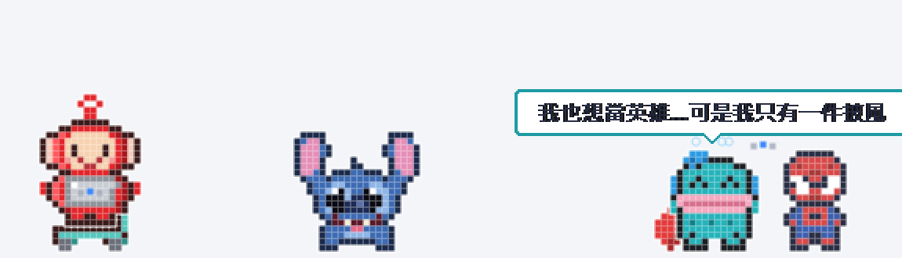
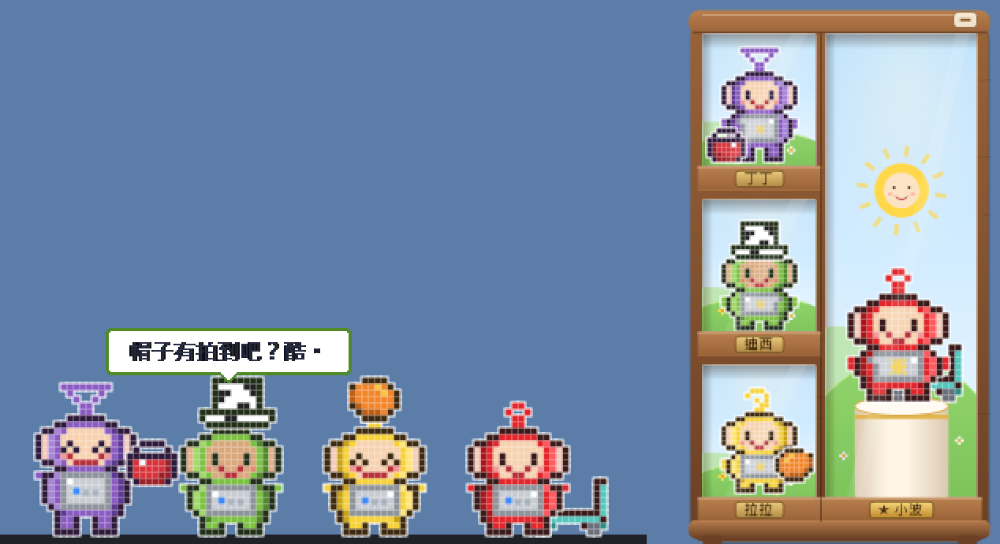

# 公仔櫃 Desk Pals

**把你家的貓狗（或任何照片）變成桌面公仔。** 選一張照片，去背、取名字、挑個性，一分鐘就有一隻自己的公仔住在螢幕右下角的蛋裡：在視窗上散步、跳上跳下、找你撒嬌，工作上有事會來提醒你，平日下班時間還會催你回家。

也有現成的公仔可以選：**經典一櫃**（Spidey、小波、史迪仔、人魚漢頓）、**天線寶寶一櫃**（丁丁、迪西、拉拉、小波）、**皮克敏一櫃**。


> 現成的幾櫃是個人粉絲作品，非商業用途，與各角色的版權方（Marvel、Ragdoll／WildBrain、Disney、Sanrio、Nintendo）無關。自己做的公仔用的是你自己的圖。

## 做一隻自己的公仔 🐾

第一次打開時的設定視窗就有「把你家的貓狗（或任何照片）變成桌面公仔」；之後隨時從**公仔小屋**（蛋或櫃子按右鍵）→「做一隻自己的公仔」再做一隻、修改、刪除。

1. **選照片**：PNG、JPG、GIF、BMP 都可以，拖進視窗或點一下選檔。
2. **去背**：本來就是透明背景的圖直接用；一般照片會自動去背（從照片四邊取背景色，毛邊會半透明，只留下最大的那一塊）。沒去乾淨就調「去背強度」，或用「擦掉／補回」筆刷在圖上塗一下修正。
3. **動起來**：兩條線把圖切成頭、身體、腳（會自動猜位置，可以拖），走路會擺腳、點頭、跳起來拉長、被抓起來晃來晃去、睡覺歪一邊。不切線也行，整隻一起搖搖晃晃。
4. **取名字、選個性**：活潑、酷酷、害羞、搞笑、喵系、汪系。個性決定他講什麼話、怎麼動：喵系會跳上視窗頂端坐著、窩成貓貓窩、偶爾把小杯子推下視窗、摸他有時候不理你等一下又自己跑回來；汪系會搖尾巴、把你丟的球叼回來、你離開電腦回來時開心地跳。

風格可以選 **保留原圖**（照片原本的樣子，邊緣平滑）或 **像素風**（縮成跟內建公仔一樣的像素畫、減色、加深色外框）。大小會自動調成跟內建公仔差不多，櫃子、蛋都放得下。

小技巧：
- **去背好的透明 PNG 效果最好**；主角站在單純的背景前（白牆、地板）也很好去背。
- 背景很亂的照片，可以先用免費的線上去背工具做成透明 PNG 再放進來。
- **照片只存在你的電腦裡**，不會上傳到任何地方（全部在本機算，不用任何網路服務或 AI）。

**進階：動作表**。想自己畫每一個動作的話，按「下載動作表範本」，在格子裡畫好「站、走 1、走 2、跳、睡、開心、被抓、坐」（至少要畫「站」，空格會自動補動畫），再按「上傳畫好的動作表」。

**我的櫃**：做了自己的公仔之後多一櫃「我的櫃」，最多放 4 隻（自己做的優先，空的格子可以請內建公仔來作客，跟他們串門子：打招呼抱抱、聊天、傳球）。也可以「只要一隻」，讓他自己住在蛋裡。

**分享短片**：小屋或公仔的右鍵選單「做分享短片（GIF）」，會在背景畫一段 5 秒的小短片（走進來、打招呼、開心跳兩下冒愛心，右下角有 Desk Pals 小浮水印），存到「圖片\Desk Pals」，順便把一句分享用的話（例如「我家 ○○ 住進我電腦了 🐾 #我的桌面公仔 #DeskPals」）複製到剪貼簿。短片是程式自己畫的，不會錄到你的螢幕。

**傳給朋友**：小屋 →「我的公仔」→「匯出成檔案」存成一個 `.deskpal` 檔；朋友在小屋或第一次設定按「匯入朋友的公仔」（或直接拖進「做一隻自己的公仔」視窗）就能養同一隻。只有自己做的公仔能匯出。

## 現成的公仔：經典一櫃



| | 公仔 | 怎麼動 | 招牌 | 下班時間 |
|---|---|---|---|---|
| 🕷 | **Spidey** | 噴絲擺盪、倒吊、爬牆 | 「蜘蛛感應！」 | 黑化，冷冷地催你下班 |
| 🛴 | **小波** | 騎滑板車在視窗間飛 | 肚子電視顯示 Codex／Claude 狀態；棒球接球、揮棒全壘打 | 太陽寶寶下山，想睡覺 |
| 👽 | **史迪仔** | 四腳快跑、爬牆、倒掛、縮成球滾 | 「Ohana！」、彈烏克麗麗 | 抱著烏克麗麗打哈欠 |
| 🐟 | **人魚漢頓** | 像在水裡游、吐泡泡；披風英雄飛行 | 冷笑話「好笑嗎？好笑嗎？」 | 睡在泡泡裡 |

- **點櫃子裡的公仔**叫他出來；**往右下一甩**就丟回櫃子（「進球！🏀」）。
- 櫃子可以**收合成一顆蛋**，點蛋就打開。
- 平日 **12:00–13:30 午餐變身**：Spidey 吃披薩、小波捧嘟嘟糊、史迪仔啃三明治、人魚漢頓喝港式奶茶配菠蘿油，吃飽還會睡午覺。

全部放出來時，他們碰在一起會有專屬劇情：史迪仔偷騎小波的滑板車、Spidey 用絲把小波盪上高處、人魚漢頓想跟 Spidey 學當英雄……還會一起拍大合照、打迷你棒球賽。

## 天線寶寶一櫃



大格是小波，左邊三格是丁丁、迪西、拉拉。四隻都用小波的像素母版，只換顏色和天線；格子裡是藍天綠山丘，大格有太陽寶寶（下班時間會下山）。

| | 公仔 | 怎麼動 | 招牌 | 下班時間 |
|---|---|---|---|---|
| 👜 | **丁丁** | 最高、走得慢慢的，提著紅色魔法袋 | 翻魔法袋（吐司、愛心、星星…）；常常跌坐「哎喲！」；愛跳舞 | 抱著袋袋打瞌睡 |
| 🎩 | **迪西** | 跟著節奏一點一點地走，有點酷 | 黑白乳牛紋高帽：丟起來接住、摘下來揮、用帽子頂球，就是不借人 | 帽子拉低蓋住眼睛 |
| 🟠 | **拉拉** | 蹦蹦跳跳、邊走邊帶球 | 顛球、轉圈圈、唱「啦啦啦～」 | 坐著抱球睡 |
| 🛴 | **小波** | 跟經典一櫃同一隻 | 滑板車、棒球 | 太陽寶寶下山 |

- 串場：丁丁借戴迪西的帽子結果跌倒、拉拉的球滾進魔法袋（先拿出吐司）、迪西和拉拉比跳舞、丁丁借騎小波的滑板車、小波打棒球給迪西用帽子頂、拉拉踢球給小波騎車去撿。
- 三隻以上：大抱抱、拉拉起頭一起唱歌、「一、二、三」一起跌倒、吐司時間（吐司彈出來，屑屑掉滿地，小幫手「吸吸」來打掃）、大合照；右鍵選單「天線寶寶一起…」也能叫。
- 早上點名「丁丁！迪西！拉拉！小波！」，下班時間一隻一隻「說再見」回櫃子。
- 午餐：丁丁吃吐司、迪西吃嘟嘟糊（帽子不拿下來）、拉拉吐司沾嘟嘟糊。
- 換櫃：VS Code 指令「公仔櫃：換一櫃」，或設定 `deskPals.lineup`（`classic`／`teletubbies`／`pikmin`／`mine`），當場換、不用重開；挑公仔時選天線寶寶也會直接換過去。

## 陪你工作

- **Codex／Claude Code 卡住、做完** → 跳出來叫你
- **上版** → 推 tag 後盯著 CI，部署成功或失敗告訴你
- **開會** → 會前提醒、點公仔進會議、開會中自動安靜
- **提醒我…／搶票提醒 🎫** → 時間到來敲你；搶票有倒數和時鐘校對
- **專注 🍅／安靜一下** → 番茄鐘、勿擾時段
- **Jira、GitLab 待辦**、下雨、電腦狀況、下載完成、今天的小結

全部在你電腦上跑，不用任何付費服務，也不會把你的資料送出去（行事曆、Jira、GitLab 都只用你自己的帳號讀取）。

## 安裝

一個 `.vsix` 同時支援 Windows 和 Mac，在 VS Code 安裝。第一次會跳出設定視窗：做一隻自己的公仔，或選一櫃現成的；預設是「只要一隻」（他住在右下角的蛋裡），想要整個公仔櫃也可以選「整櫃」。

- **Windows**（完整公仔櫃＋做自己的公仔）：見 [Windows安裝說明.md](Windows安裝說明.md)
- **Mac**（完整公仔櫃；做自己的公仔、分享短片目前先在 Windows 版）：見 [Mac安裝說明.md](Mac安裝說明.md)

`.vsix` 從 [Actions](../../actions) 最新一次成功的建置下載（Artifacts 裡的 `desk-pals-vsix`），或自己打包：

```
python build_vsix.py
```

## 結構

| 路徑 | 內容 |
|---|---|
| `extension/extension.js` | VS Code 擴充：側邊欄、狀態列、啟動桌面版 |
| `extension/practical.js` | 實用功能的資料來源：終端機、CI、行事曆、Jira、GitLab、天氣、工作日誌、提醒 |
| `extension/media/pet.html` | 側邊欄裡的公仔 |
| `extension/desktop/DeskPals.cs` | Windows 桌面版：公仔櫃、兩櫃公仔（經典／天線寶寶）、通知（由 `desk-pals.ps1` 用 PowerShell 編譯執行） |
| `extension/desktop/DeskPals.Custom*.cs` | 自己做的公仔：去背與像素化（`CustomImage`）、做公仔視窗（`CustomMake`）、六種個性的台詞（`CustomLines`）、畫法與動作、我的櫃（`Custom`） |
| `extension/desktop/DeskPals.Share.cs` | 分享短片（自己寫的 GIF 編碼器）、`.deskpal` 匯出／匯入 |
| `extension/desktop/DeskPals.swift` | Mac 桌面版（DeskPals.cs 的 Swift 移植，由 `desk-pals.sh` 編譯執行；由 `mac/src/*.swift` 經 `python3 mac/assemble.py` 產生，別直接改） |
| `mac/` | Mac 版原始碼與移植規範（`PORTING.md`） |
| `extension/desktop/claude-hook.js`、`ci-watch.js` | Claude Code hooks、推 tag 後盯 CI |
| `build_vsix.py` | 打包成 `.vsix` |

每次推送都會在雲端的 Windows 和 Mac 上各編譯、試跑一次（都用不顯示畫面的離屏模式）。
