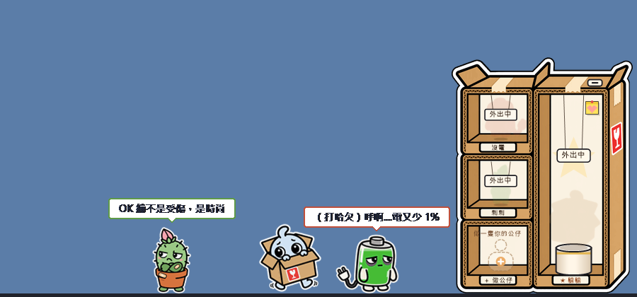

# 公仔櫃 Desk Pals：Windows 安裝說明

螢幕右下角會出現一個小小的木頭公仔櫃，裡面住著四隻像素公仔：**續命小隊**——珍奶**半糖**、咖啡**醒醒**、飯糰**糰糰**、便利貼**貼貼**。挑一隻出來，他就在整個螢幕陪你：在視窗上散步、抱抱、敲螢幕，工作上有事會來提醒你，平日下班時間還會催你回家。



也可以換成程式裡的其他幾櫃（經典一櫃、天線寶寶一櫃、皮克敏一櫃）。

> 續命小隊是原創角色。其他幾櫃是個人粉絲作品，非商業用途，與各角色的版權方無關。

## 需要先有

- Windows 10 或 11
- VS Code

不用另外裝其他東西。

## 安裝

1. 把 `desk-pals-<版號>.vsix` 放到任意資料夾。
2. VS Code → 左邊「延伸模組」→ 右上角「⋯」→「從 VSIX 安裝…」→ 選這個檔。
3. 重新開啟 VS Code，會跳出「歡迎來到公仔櫃」設定視窗（你是？→ 選一櫃 → 怎麼擺），預設選好的就是續命小隊。

幾秒後公仔櫃和你挑的公仔就會出現。以後開機會自動出現，不用開 VS Code。

## 怎麼玩

**公仔櫃**
- **點櫃子裡的公仔**：叫他出來，或收回去。可以同時放好幾隻出來，他們碰到會串門子、聊天、一起玩。
- **把公仔拖回櫃子**：他就回格子裡乖乖待著。
- 右邊的大格子放你**最常用的那隻**。右鍵選「設為最愛」可以自己指定。
- **往右下角一甩**：在螢幕任何地方抓起公仔往櫃子丟，他會自己飛進格子。
- **收合成蛋**：按櫃子頂端的「－」或右鍵「收合成蛋」，櫃子變成一顆蛋；點蛋就打開。
- **午餐時間**（平日 12:00–13:30）：公仔會換上午餐造型邊吃邊聊，吃飽睡午覺，13:30 一起回來工作。

**跟公仔互動**
- **點他**：每隻有自己的反應。連點會有驚喜。
- **按住拖曳**：把他丟出去。
- **右鍵**：選單，有換角色、全部放出來、丟球、大合照、提醒我、搶票提醒、搶課提醒、考試倒數、這週要交的、專注、安靜一下、今天的小結、收工。
- **Ctrl＋Alt＋S**：全部躲起來／出來。分享螢幕開會時會自己躲起來。

**續命小隊的個性**
- **半糖 🥤（珍奶）**：甜甜的、愛揪團。蹦蹦跳跳，珍珠跟著彈；拔下吸管撐竿跳上視窗、連點會噴珍珠；丟球給她，她把球吸進吸管再「噗」回來。
- **醒醒 ☕（咖啡馬克杯）**：白天永遠沒睡醒、一直打哈欠；右鍵「續杯！」咖啡壺從天而降，喝完眼睛睜大、抖著暴衝。晚上反而精神超好（黑眼圈），但會叫你去睡。
- **糰糰 🍙（三角飯糰）**：憨厚愛吃，見人就問「吃飽沒？」。把海苔脫下來當板子衝浪、用飯匙殺球、從視窗邊滾下去。
- **貼貼 📝（便利貼）**：黏人又細心。飛去貼在視窗上（沒有視窗就貼在你的螢幕上），寫便條丟給你；掉下來像紙一樣飄。
- 全部放出來會串門子：珍珠拿鐵、超商早餐組合價、揪團訂飲料、早餐要吃、死線前一晚、「我就是午餐耶？」；三隻以上還會揪團訂飲料、下午三點下午茶乾杯、大合照。右鍵選單「續命小隊一起…」可以直接叫。早上點名「續命小隊，報到！」，下班時一個一個回櫃子。
- 午餐：半糖雞排配珍奶、醒醒可頌、糰糰雞腿便當、貼貼滷肉飯。

**經典一櫃（粉絲作品）**
- **Spidey**：噴絲擺盪、倒吊、爬牆；下班時間會黑化。
- **小波**：騎滑板車在視窗間飛來飛去；肚子上的電視會顯示 Codex／Claude 的狀態；丟棒球給她，她會用手套接、偶爾揮棒打全壘打。
- **史迪仔**：爬牆、倒掛在視窗底下、縮成球滾；會彈烏克麗麗。
- **人魚漢頓**：在空中像在水裡游泳、吐泡泡；夢想當英雄，會披著披風飛；很愛講冷笑話。

**天線寶寶一櫃（粉絲作品）**
- **換櫃**：`Ctrl+Shift+P` 執行「公仔櫃：換一櫃」，或在設定 `deskPals.lineup` 選 `original`（續命小隊）／`classic`／`teletubbies`／`pikmin`。當場就換，不用重開。挑公仔（「公仔櫃：換角色」）時選丁丁、迪西或拉拉，也會直接換成天線寶寶一櫃。
- 每一櫃各自記得誰在外面、誰是最愛；小波在經典和天線寶寶兩櫃都有，好感度是同一份。

| 公仔 | 個性 | 招牌動作 |
|---|---|---|
| 丁丁 👜 | 最高、溫和、走得慢 | 提著紅色魔法袋，翻出吐司、愛心、星星；常常跌坐「哎喲！」；愛跳舞 |
| 迪西 🎩 | 酷酷的、有點固執 | 黑白乳牛紋高帽：丟起來接住、摘下來揮、用帽子頂球；帽子不借人（借給丁丁就出事） |
| 拉拉 🟠 | 開朗、愛唱歌 | 帶著大橘球蹦蹦跳、顛球、轉圈圈、唱「啦啦啦～」 |
| 小波 🛴 | 跟經典一櫃同一隻 | 滑板車、棒球（丟棒球給大家：丁丁用袋子接、迪西用帽子頂、拉拉用腳踢） |

全部放出來，他們會串門子：借帽子、球滾進魔法袋、比跳舞、借騎滑板車、帽子棒球、踢球撿球；三隻以上還會大抱抱、一起唱歌、一起跌倒、吐司時間（小幫手「吸吸」來打掃）。右鍵選單「天線寶寶一起…」可以直接叫。早上會點名「丁丁！迪西！拉拉！小波！」，下班時間一隻一隻「說再見」回櫃子。

**越常互動感情越好**：等級升上去會戴上配件。節日（聖誕節、農曆新年、你的生日）會換造型。生日在 VS Code 設定 `deskPals.birthday` 填，格式 `MM-DD`。

## 工作上的提醒（都在你電腦上跑，不花錢）

| 功能 | 說明 | 要設定嗎 |
|---|---|---|
| Codex／Claude 卡住 | 在問你問題、在等你按允許、或很久沒回應時，公仔會跳出來提醒；做完一件比較久的工作也會告訴你 | 不用 |
| 終端機長指令 | VS Code 終端機的指令跑超過 30 秒，跑完告訴你成功或失敗 | 不用 |
| 上版結果 | 終端機 `git push` tag 後盯著 CI，部署成功或失敗都告訴你（GitHub 公開 repo，或已用 glab 登入的 GitLab） | 不用 |
| 提醒我… | 右鍵或 VS Code 指令，打一句話選時間，時間到他來叫你 | 不用 |
| 搶票提醒 🎫 | 輸入開賣日期、時間、售票網址，開賣前 1–2 小時、30 分、10 分、1 分和開搶時各叫一次，最後 10 分鐘有倒數，點他直接打開售票頁 | 不用 |
| 搶課提醒 🎓 | 跟搶票一樣，輸入選課系統開放的日期、時間、選課網址：開放前 1–2 小時、30 分、10 分、1 分和開放時各叫一次，最後 10 分鐘頭上有學士帽倒數 | 不用 |
| 考試倒數 📚 | 右鍵「小幫手 → 考試倒數…」加考試：考前兩週每天 20:00 倒數（點泡泡就開始讀書 25 分鐘）、前一天晚上叫你早點睡、當天早上加油；7 天內「專注」變成「讀書 25 分鐘」 | 不用（學校行事曆上寫「期中考」「小考」的也會自動加進來） |
| 熬夜提醒 🌙 | 01:00 後還在用電腦，公仔會溫柔催你去睡，02:00、03:00 再講一次；你離開電腦、安靜、專注時不吵 | 不用（時間在「讀書小幫手設定」改，也可以關掉） |
| 上課提醒 🎒 | 上課前 10 分鐘和開始時提醒，點他打開上課連結；上課、考試中自動安靜 | 公仔小屋 →「讀書小幫手設定」貼學校行事曆網址（見下面） |
| 作業死線 📝 | 截止前 3 天、1 天、3 小時、1 小時提醒，點他打開作業頁或標成「交了」；右鍵「小幫手 → 這週要交的」看清單 | 同上 |
| 專注 25 分鐘 🍅 | 番茄鐘：專注時公仔安靜陪你，時間到才提醒休息 | 不用 |
| 安靜一下 | 30 分鐘／2 小時／到下班，期間的通知先存著，結束時一次告訴你 | 不用 |
| 電腦狀況 | CPU、記憶體一直滿載、硬碟快滿、網路斷線時告訴你 | 不用 |
| 下載完成 | 下載資料夾有新檔案下載好時通知，點他打開 | 不用 |
| 今天的小結 | 下班時告訴你今天專注了幾輪（這週共幾顆番茄）、上了幾次版、Codex／Claude 做完幾件事；有學校行事曆的話加上今天上了幾堂課、這週還有幾份作業 | 不用 |
| 開會提醒 | 會前 5 分鐘和開始時提醒，點他進會議；開會中自動安靜 | 在設定 `deskPals.calendarIcsUrl` 填行事曆的 ICS 私人網址 |
| 下雨提醒 | 平日 17:30 看等一下下班和明天會不會下雨 | 在設定 `deskPals.weatherLocation` 填城市，例如「台北」 |
| Jira 新單／到期／被 @ | 有新單指派給你、單子快到期、有人在留言 @你 | 執行指令「公仔櫃：設定 Jira」 |
| GitLab 待辦 | 有人請你 review、MR 指派給你、@你、pipeline 失敗 | 先用 glab 登入，再在設定 `deskPals.gitlabHosts` 加上主機 |
| 工作日誌 | 指定資料夾出現今天的新檔時通知你 | 在設定 `deskPals.worklogDir` 填資料夾 |

VS Code 設定：`Ctrl+,` → 搜尋 `deskPals`。

### 學校行事曆網址怎麼拿（上課提醒、作業死線）

在公仔小屋（右鍵蛋或櫃子）→「讀書小幫手設定」，把網址貼進「學校行事曆」，好幾個就一行一個（`https://` 或 `webcal://` 開頭都可以）。有用 VS Code 的話也可以填設定 `deskPals.schoolIcsUrl`，填了就以 VS Code 的為準。沒開 VS Code 也會提醒。

- **Canvas／NTU COOL**：左邊「行事曆」→ 右邊欄最下面「Calendar Feed（行事曆摘要）」→ 複製網址。作業、測驗、討論區的截止都在裡面。
- **Moodle**：「行事曆」→「匯入或匯出行事曆」→「匯出行事曆」→ 事件選「所有事件」、時間選最近和接下來 →「取得行事曆網址」→ 複製。
- **Google Classroom**：課程的「課業」頁 →「Google 日曆」打開這門課的日曆 → Google 日曆左邊找到這門課 →「設定和共用」→「iCal 格式的私密網址」。每門課一個網址。（學校帳號的私密網址如果被管理員關掉，就沒辦法用這個方法。）
- **自己排的 Google 日曆課表**：Google 日曆設定 → 你的日曆 →「iCal 格式的私密網址」。每週重複的行程會被當成上課。

私密網址等於密碼，不要貼給別人。開會用的那份（`deskPals.calendarIcsUrl`）不用再填一次；同一份兩邊都填也只會提醒一次。

### 用 Claude Code 的話（選用）

Codex 不用設定。Claude Code 想要「做完通知」的話，把下面這段加進 `C:\Users\你的帳號\.claude\settings.json` 最外層的 `{ }`（`你的帳號` 換成自己的 Windows 帳號名稱）：

```json
"hooks": {
  "UserPromptSubmit": [{ "hooks": [{ "type": "command", "command": "node \"C:/Users/你的帳號/AppData/Local/DeskPals/claude-hook.js\" start", "timeout": 3 }] }],
  "Stop": [{ "hooks": [{ "type": "command", "command": "node \"C:/Users/你的帳號/AppData/Local/DeskPals/claude-hook.js\" done", "timeout": 3 }] }],
  "Notification": [{ "hooks": [{ "type": "command", "command": "node \"C:/Users/你的帳號/AppData/Local/DeskPals/claude-hook.js\" wait", "timeout": 3 }] }],
  "PostToolUse": [{ "matcher": "Bash", "hooks": [{ "type": "command", "command": "node \"C:/Users/你的帳號/AppData/Local/DeskPals/claude-hook.js\" post", "timeout": 3 }] }]
}
```

## 不想要了

在 VS Code 按 `Ctrl+Shift+P`，執行「公仔櫃：收工（關掉整個螢幕版）」。公仔和櫃子會離開，下次開機也不會再出現。

## 沒出現怎麼辦

看這個檔有沒有錯誤訊息：`%TEMP%\desk-pals.log`（在檔案總管網址列貼上就能打開）。
